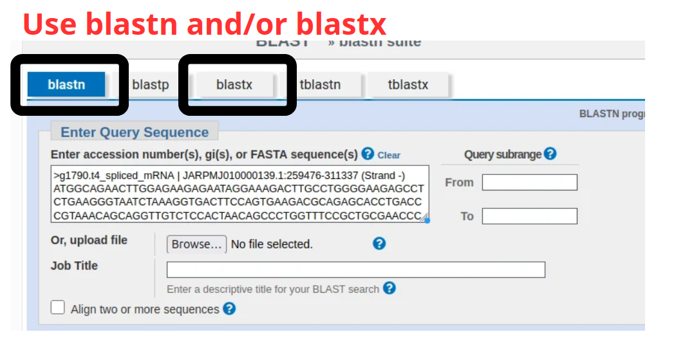
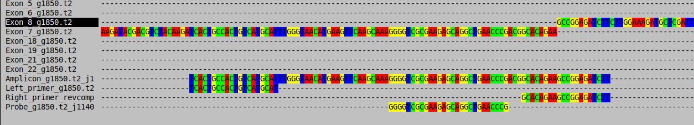
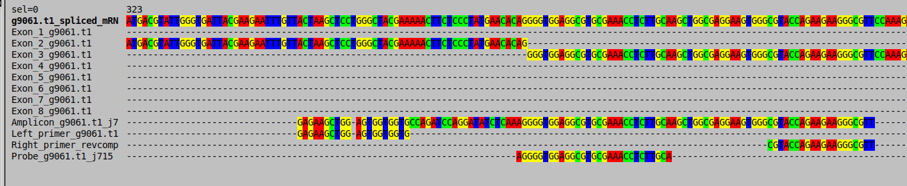

# RAPID — Manual & Tutorial

**R**NA **A**utomated **P**rimer **I**dentification and **D**esign

This manual covers concepts, installation, every mode and option, choosing filter thresholds, checking candidate primers by hand (`fetch_gene`, BLAST, SeaView), the interactive reports, reproducibility, parallel runs, and troubleshooting. For a short overview see `README.md`.

---

## 1. Concept

RAPID designs primers whose 3′ end straddles an **exon–exon junction** of a spliced transcript. Such a primer can only anneal on mature mRNA (where the two exons are contiguous), not on genomic DNA (where an intron separates them). This gives RNA-specific assays without relying solely on a DNase step.

The design is driven by RNA-seq: genes are selected by their expression, and — in `track` mode — by their **specificity to one reference stage/condition**.

Pipeline (mode `auto`):

1. **Alignment** — HISAT2 (splice-aware), then SAMtools sort/index.
2. **Quantification** — featureCounts, per gene, at the exon level.
3. **Gene selection & junctions** — DESeq2 size-factor normalisation, selection by expression stratum, computation of internal exon–exon junctions, export of exon BED + a Primer3 preconfig with the junction directives.
4. **Spliced templates** — BEDTools extracts exons; they are concatenated per gene.
5. **Primer3** — one config per gene, run in parallel (GNU Parallel), with a per-gene timeout. With `--probe`, an internal hybridization probe is designed alongside each pair.
6. **Ranking & summary** — best pairs by penalty → `best_primers.txt` + `primers_summary.tsv` (column reference in §5).

`track` inserts a reference-specificity filter between steps 3 and 4; everything downstream is identical. `check` and `fetch_gene` are separate validation/inspection workflows (§8, §9).

---

## 2. Installation

```bash
rapid install                 # create the 'rapid' env from rapid.yaml
rapid install --update-only   # update an existing env
conda activate rapid
```

The `rapid` environment contains: Snakemake, HISAT2, SAMtools, Subread (featureCounts), BEDTools, Primer3, GNU Parallel, exonerate (provides `ipcress`), R with DESeq2/dplyr/tidyr, and folium (biogeography maps).

**AGAT (for GFF3 → GTF conversion and for Remove the isoforms from the annotation) is intentionally NOT in this environment** — it pulls a large Perl stack that conflicts with the pinned dependencies. Install it in its own environment when needed (see §12).


---

## 3. Inputs

**Genome** — FASTA, **decompressed** (HISAT2 and BEDTools do not read `.gz`) and ideally **soft-masked** (repeats in lowercase). Do **not** hard-mask (Ns break alignment and primer design).

```bash
gunzip -k genome.fa.gz        # keep the .gz, produce genome.fa
```

**Annotation without isoform** — **GTF preferred**. RAPID detects the format from the file extension:
- `.gtf` → featureCounts uses `-g gene_id`, and reproducible splice sites are extracted for HISAT2 (see §13).
- `.gff/.gff3` → featureCounts uses `-g Parent` (aggregates per **transcript**, not per gene) and the HISAT2 reproducibility safeguard is skipped.

If your annotation is GFF3, convert it to GTF first (see §12).

If your annotation has isoforme, use AGAT (see §12).

**RNA-seq reads** — FASTQ(.gz). One file = single-end; two files (R1 R2) = paired-end.

---

## 4. Mode `auto`

Full pipeline on a single RNA-seq sample.

```bash
rapid auto -g genome.fa -r R1.fq.gz R2.fq.gz -o results/ -a annotation.gtf
```

### Options

| Option | Default | Meaning |
|--------|---------|---------|
| `-g, --genome` | — | Reference genome (FASTA). **Required.** |
| `-r, --rna` | — | 1 file (SE) or 2 files (PE R1 R2). **Required.** |
| `-o, --output` | — | Output directory. **Required.** |
| `-a, --annot` | — | Annotation (GTF/GFF3). |
| `-ex, --expression` | `500` | Expression stratum: `max`/`+` (top 33%), `mid` (33–66%), `min` (bottom 33%), `N` (top N), `-N` (bottom N). |
| `--primer-product-min` | `100` | Minimum amplicon size (bp). |
| `--primer-product-max` | `200` | Maximum amplicon size (bp). Must be > min. |
| `--top-primers` | `10` | Number of best pairs to keep (by penalty). |
| `--probe` | off | Also design an internal hybridization probe (TaqMan-style) for each amplicon. See "Probe design" below. |
| `--probe-size-min` | `18` | Minimum probe size (nt). |
| `--probe-size-max` | `30` | Maximum probe size (nt). |
| `--probe-tm-offset-min` | `8` | Minimum Tm offset (°C) targeted between the probe and the primers. |
| `--probe-tm-offset-max` | `10` | Maximum Tm offset (°C) targeted between the probe and the primers. |
| `-p, --primer3-param` | — | Extra Primer3 global parameter `KEY=VALUE`, repeatable (e.g. `-p PRIMER_MIN_SIZE=18`). |
| `--primer3-jobs` | = `--threads` | Parallel Primer3 processes (one gene each). |
| `--primer3-timeout` | `7200` | Per-gene wall-clock limit (s); a gene exceeding it is excluded. `0` disables. |
| `--threads` | `8` | CPU threads per tool. |
| `--snakemake-args` | — | Extra flags passed to Snakemake, e.g. `'--dryrun'`. Quote the string. |

### Expression modes explained

Genes must be **multi-exonic** (a junction requires ≥ 2 exons). Among those, RAPID ranks by normalised expression and keeps the chosen stratum. Use `-ex N` (e.g. `-ex 50`) to design primers for a fixed number of the most-expressed genes.

### Probe design (`--probe`)

With `--probe`, RAPID also asks Primer3 to pick an **internal hybridization oligo** (a TaqMan-style probe) for every amplicon, in the same run as the primers. Three design rules are enforced or approximated:

- **Size** — between `--probe-size-min` and `--probe-size-max` nt (default 18–30 nt), passed directly to Primer3 as `PRIMER_INTERNAL_MIN_SIZE`/`PRIMER_INTERNAL_MAX_SIZE`.
- **Tm offset above the primers** — Primer3 has no native "relative to the primers" constraint, so RAPID approximates it: it sets the probe's Tm window to `PRIMER_OPT_TM` (the primers' target Tm — either your own `-p PRIMER_OPT_TM=…` override, or Primer3's default of 60 °C) **+ `--probe-tm-offset-min`** to **+ `--probe-tm-offset-max`** (default +8 to +10 °C). The *actual* offset obtained for each pair — computed from the real Tm values Primer3 returned — is reported per row in `primers_summary.tsv` as `Probe_Tm_Offset_vs_Primers` (§5), so you can verify it gene by gene.
- **Avoiding a 5′ G** — a probe starting with a G quenches the reporter fluorophore even after hydrolysis, so it is best avoided on hydrolysis (TaqMan-style) probes. Primer3 has no native rule for this either, so RAPID asks Primer3 for several candidate primer pairs per gene/junction (`PRIMER_NUM_RETURN=5`) and automatically keeps the best-ranked one whose probe does **not** start with a G. This is a best-effort choice, not a hard guarantee: if every candidate pair's probe starts with a G, RAPID falls back to the best pair anyway and flags it via `Probe_Starts_With_G=yes` in the summary table.

Without `--probe`, the probe-related columns of `primers_summary.tsv` are simply filled with `NA`.

---

## 5. Understanding `primers_summary.tsv`

`primers_summary.tsv` (in `primer3/results/`) is the main deliverable of `auto` and `track`: one row per kept primer pair, with every metric needed to judge and pick a candidate. It is produced by `scripts/primer3_summary.py` from `best_primers.txt`. This section describes every column.

### Identification & automatic QC

| Column | Meaning |
|--------|---------|
| `Gene_Junction` | Primer3's internal `SEQUENCE_ID` for this record: `<gene>_j<junction position>`. |
| `Gene` | The gene ID alone (`Gene_Junction` with the trailing `_j<N>` removed). |
| `Junction` | The exon–exon junction position (bp from the start of the spliced transcript) this pair straddles — the `<N>` from `Gene_Junction`. |
| `Quality` | Automatic flag, from Primer3's own metrics: `PASS_BEST` (penalty < 0.1, primer ΔTm < 1 °C, no strong hairpin, no strong dimer), `PASS` (penalty < 0.3, ΔTm < 2 °C, dimer below a safe threshold), `REVIEW` (fails one of the above — check by hand). |

### Primers (left = forward, right = reverse)

| Column | Meaning |
|--------|---------|
| `PRIMER_PAIR_0_PENALTY` | Primer3's overall penalty for the pair — lower is better; this is what pairs are ranked and kept (`--top-primers`) by. |
| `PRIMER_LEFT_0_SEQUENCE` / `PRIMER_RIGHT_0_SEQUENCE` | Primer sequences, 5′→3′. |
| `PRIMER_LEFT_0_TM` / `PRIMER_RIGHT_0_TM` | Melting temperature of each primer (°C). |
| `PRIMER_LEFT_0_GC_PERCENT` / `PRIMER_RIGHT_0_GC_PERCENT` | GC content of each primer (%). |
| `PRIMER_LEFT_0_SELF_ANY_TH` / `PRIMER_RIGHT_0_SELF_ANY_TH` | Self-complementarity melting temp (any alignment position). High values (roughly > 45–47 °C) suggest the primer may fold or self-dimerise. |
| `PRIMER_LEFT_0_SELF_END_TH` / `PRIMER_RIGHT_0_SELF_END_TH` | Self-complementarity at the 3′ end specifically — more critical than `SELF_ANY`, since a self-primed 3′ end can extend. |
| `PRIMER_LEFT_0_HAIRPIN_TH` / `PRIMER_RIGHT_0_HAIRPIN_TH` | Predicted hairpin melting temperature — high values mean the primer folds on itself. |
| `PRIMER_LEFT_0_END_STABILITY` / `PRIMER_RIGHT_0_END_STABILITY` | ΔG of the last 5 bases at the 3′ end. A very stable 3′ end increases the risk of mispriming. |
| `PRIMER_PAIR_0_COMPL_ANY_TH` / `PRIMER_PAIR_0_COMPL_END_TH` | Complementarity between the forward and reverse primer (any position / 3′ end) — a proxy for primer-dimer formation between the two. |
| `PRIMER_PAIR_0_PRODUCT_SIZE` | Amplicon length (bp). |
| `PRIMER_PAIR_0_PRODUCT_TM` | Predicted melting temperature of the full amplicon — useful for a qPCR melt-curve check. |

### Probe (only with `--probe`; `NA` otherwise)

| Column | Meaning |
|--------|---------|
| `PRIMER_INTERNAL_0_SEQUENCE` | Probe sequence, 5′→3′. |
| `PRIMER_INTERNAL_0_TM` | Probe melting temperature (°C). |
| `PRIMER_INTERNAL_0_GC_PERCENT` | Probe GC content (%). |
| `PRIMER_INTERNAL_0_SELF_ANY_TH` / `PRIMER_INTERNAL_0_SELF_END_TH` | Probe self-complementarity (any position / 3′ end) — same reading as for the primers. |
| `PRIMER_INTERNAL_0_HAIRPIN_TH` | Predicted probe hairpin melting temperature. |
| `Probe_Size` | Probe length (nt) — should fall within `--probe-size-min`/`--probe-size-max`. |
| `Probe_Tm_Offset_vs_Primers` | `PRIMER_INTERNAL_0_TM` minus the average of `PRIMER_LEFT_0_TM` and `PRIMER_RIGHT_0_TM` — the *actual* Tm gap obtained for this pair. This is what `--probe-tm-offset-min`/`--probe-tm-offset-max` targets (default +8 to +10 °C); check it per row, since the target is only approximate (see "Probe design" in §4). |
| `Probe_Starts_With_G` | `yes`/`no` — whether the probe's 5′ base is a G. RAPID tries to avoid this automatically (§4); `yes` means every candidate pair for this gene/junction had a 5′-G probe, so it could not be avoided — review manually if this matters for your chemistry. |

### Amplicon & junction placement

| Column | Meaning |
|--------|---------|
| `Amplicon_Sequence` | Full sequence of the amplified region (from the start of the left primer to the end of the right primer). |
| `Amplicon_GC_percent` | GC content of the amplicon (%). |
| `Left_bases_before_junction` / `Left_bases_after_junction` | For the left primer: how many of its bases fall before vs. after the junction (0 if it doesn't span it). |
| `Right_bases_before_junction` / `Right_bases_after_junction` | Same, for the right primer. |

At least one primer of a validated junction-spanning pair should show non-zero values on both sides of the junction it spans (`PRIMER_MIN_3_PRIME_OVERLAP_OF_JUNCTION=4` guarantees at least 4 nt of 3′ overlap into the next exon for whichever primer is forced to span it). Use these four columns to double-check that the pair truly straddles the junction rather than sitting entirely within one exon.

---

## 6. Mode `track` — stage/condition-specific primers

`track` takes one **reference** sample (`--ref`) and any number of **other** samples (`--other`, repeatable), typically different stages or treatments of the same species. It keeps only genes specific to the reference, then designs primers exactly as in `auto`.

```bash
rapid track -g genome.fa -o results_track/ -a annotation.gtf \
    --filter cpm --min-cpm-ref 1 --fold-change 10 \
    --ref   cercariae_R1.fq.gz cercariae_R2.fq.gz \
    --other stageA_R1.fq.gz stageA_R2.fq.gz \
    --other stageB_R1.fq.gz stageB_R2.fq.gz
```

Each `--other` accepts 1 (SE) or 2 (PE) files and can be repeated for as many samples as you like. Samples are named `ref`, `other_1`, `other_2`, … internally.

### The two filters

**`--filter absolute`** *(default, raw counts)* — keep a gene if `ref count ≥ --ref-min-count` **and** `every other count ≤ --other-max-count`.
- `--ref-min-count` (default 10), `--other-max-count` (default 0).
- Simple presence/absence, but depth-dependent and blind to enrichment. With real data, `--other-max-count 0` is very strict; you will usually need to raise it.

**`--filter cpm`** *(recommended)* — keep a gene if `CPM_ref ≥ --min-cpm-ref` **and** `CPM_ref ≥ --fold-change × CPM_other` for **every** other sample.
- `--min-cpm-ref` (default 1.0), `--fold-change` (default 10.0).
- CPM = count / (library size / 1e6). This normalises for sequencing depth and captures **enrichment**, which is the right notion for a stage-specific marker.

All other `auto` options (`-ex`, product size, `--top-primers`, Primer3 params, timeout, threads) apply. Expression ranking is computed on the reference sample.

### Choosing thresholds without prior knowledge

Use the helper `track_cpm_scan.py` on the per-sample count tables produced by a run (no need to re-run the pipeline). It reports how many genes you would keep at each fold-change:

```bash
python3 Rapid/scripts/track_cpm_scan.py \
    --ref    results_track/featurecounts/counts_ref.txt \
    --others results_track/featurecounts/counts_other_*.txt \
    --min-cpm-ref 1 --fold-grid 2 3 5 10 20 50
```

Pick the smallest fold-change that yields a workable number of candidates (a few dozen to a few hundred).

### Output specific to `track`

In addition to the standard outputs, `track` writes an **enriched primer report** (`primer3/results/primer_report.tsv` and `.html`). See §7.

---

## 7. Choosing the best primers — the primer report

`track` runs generate `primer_report.tsv` (a table) and `primer_report.html` (a self-contained interactive page — open it in any browser). For each kept primer pair the report gives:

- amplicon (product) size, Primer3 penalty, primer Tm and GC%
- the gene's CPM in **every stage** (reference first)
- the **enrichment** fold-change (reference vs. the most-expressed other stage) and the limiting stage

In the HTML page you can:

- **Sort** by enrichment ↓, amplicon size ↑, penalty ↑, or gene.
- **Filter** by minimum enrichment and amplicon size range.
- **Expand** a row to see a per-stage CPM bar chart (reference highlighted).
- **Discard** unwanted pairs with the ✕ button; the list narrows as you review. Your selection persists across reloads. Use *View hidden* to review/restore, *Restore all* to reset.
- **Download** your kept selection as a TSV.

Recommended workflow: sort by enrichment, then among the top pairs pick the lowest penalty and an amplicon size in your target window; expand to confirm no other stage is expressed.

The stage labels (e.g. `cercariae`, `stageA`) are read from `rapid_track_config.yaml` — they are the folder names of your reads. If reads are not organised in named folders, generic labels (`other_1`, …) are used.

You can regenerate the report at any time without re-running the pipeline:

```bash
python3 Rapid/scripts/primer_report.py results_track/
```

---

## 8. Mode `check` — in-silico validation

`check` runs electronic PCR (ipcress, from exonerate) with your candidate primers against a sequence database, to assess specificity and possible cross-amplification.

```bash
# against an NCBI TSA nucleotide database (per-species transcriptomes)
rapid check -i results_track/ -tsa /path/to/tsa/nucl/ --maps

# against a single custom FASTA database
rapid check -i my_primers.tsv -d sequences.fasta -c 5 -min 80 -max 300
```

### Options

| Option | Default | Meaning |
|--------|---------|---------|
| `-i, --input` | — | A `rapid` output directory (auto-finds `primers_summary.tsv`) or a TSV with forward in col 1, reverse in col 2. **Required.** |
| `-tsa` / `-d, --database` | — | TSA directory **or** a single FASTA(.gz). One is **required**. |
| `-o, --output` | `<input>/check/` | Output directory. |
| `-c` | `10` | Number of top pairs to test. |
| `-min, --min-size` | `70` | Minimum expected amplicon (bp). |
| `-max, --max-size` | `250` | Maximum expected amplicon (bp). |
| `--mismatch` | `3` | Maximum mismatches allowed by ipcress. |
| `--maps` | off | Also generate GBIF biogeography maps (needs internet). |
| `--threads` | `4` | Parallel ipcress jobs (one per database file). |

`check` is resumable: each database file is processed independently and cached, so an interrupted run resumes where it stopped. Re-running later with `--maps` only generates the maps.

### Species report (TSA)

With a TSA database, `check` extracts the species behind each hit and writes:

- `check/species_by_pair.tsv` — a pair × species matrix (amplicon counts).
- `check/species_explorer.html` — an interactive page. Uncheck species you don't care about; a pair turns green once it no longer amplifies any checked species. This makes it easy to see which pairs stay specific once you disregard acceptable off-targets.

---

## 9. Mode `fetch_gene` — inspect a gene and its primers

`fetch_gene` rebuilds, for a gene/junction you are interested in, everything needed to look at it by hand: the exon sequences, the reconstructed spliced mRNA, and the amplicon, primers and probe chosen by RAPID. It also writes a FASTA file that can be opened directly in [SeaView](https://doua.prabi.fr/software/seaview) to check, on an alignment, that the primers really sit on an exon–exon junction. It is the starting point of the manual validation workflow described in §10.

```bash
# one gene, one junction
rapid fetch_gene -d results/ -g g9316 -j 183

# every junction of one gene
rapid fetch_gene -d results/ -g g9316

# every gene/junction listed in primers_summary.tsv
rapid fetch_gene -d results/
```

Works on the output directory of `auto` **and** `track`. Run it inside the `rapid` conda environment (it needs `samtools`, or `pyfaidx` as a fallback).

### Options

| Option | Meaning |
|--------|---------|
| `-d, --dir` | RAPID results directory (the one given to `-o` for `auto`/`track`). **Required.** |
| `-g, --gene` | Gene ID. `g9316`, `9316` and `gene:g9316` are treated as the same gene; IDs such as `Smp_123456` are kept as is. Without `-g`, all genes are processed. |
| `-j, --junction` | Junction position, as in the `Junction` column of `primers_summary.tsv` (§5). Requires `-g`. Without `-j`, all junctions of the selected gene(s) are processed. |

### How it works

- Reads `rapid_config.yaml` (or `rapid_track_config.yaml`) to find the genome, and whether a probe was designed (`design_probe`).
- Reads the primers from `primer3/results/primers_summary.tsv`.
- Gets the exon coordinates, strand and chromosome of the gene from the `featurecounts/` files (`counts.txt` in `auto`; the reference sample's counts file in `track`).
- Extracts every exon from the genome, reverse-complements them if the gene is on the `-` strand, and concatenates them in transcript order.

When several genes are processed, a gene that cannot be found is skipped (and listed at the end) instead of stopping the run.

### Outputs

Written to `<results>/Find_genes/`, for each gene/junction:

| File | Content |
|------|---------|
| `<gene>_j<N>_report.txt` | Human-readable report: chromosome, strand, coordinates, number of exons; primer (and probe) sequences, Tm and product size; amplicon sequence; every exon; the reconstructed mRNA. |
| `<gene>_j<N>_for_align.txt` | Multi-FASTA to open in SeaView: `…_spliced_mRNA`, one `Exon_<i>_…` record per exon, `Amplicon_…`, `Left_primer_…`, `Right_primer_revcomp_…` and (with `--probe`) `Probe_…`. |

The right primer is written **reverse-complemented**, so that every sequence of the file is in the same orientation as the mRNA and the amplicon and can be aligned directly.

---

## 10. Choosing and verifying primers by hand

The automatic `Quality` flag, the primer report (§7) and `check` (§8) narrow the list down, but before ordering oligos it is worth looking at a few finalists yourself. Three checks are recommended: a BLAST sanity check (NCBI), the junction placement (SeaView), and — optionally — the in-silico PCR of `check`.

### Step 1 — Shortlist candidates

Start from `primers_summary.tsv` (or `primer_report.html` in `track`). Typical criteria: `Quality` = `PASS_BEST` or `PASS`, a low `PRIMER_PAIR_0_PENALTY`, an amplicon size in your target window, similar primer Tm values, and — for `track` — a high enrichment. Note the `Gene` and `Junction` values of each finalist.

### Step 2 — Extract the sequences

```bash
rapid fetch_gene -d results/ -g <gene> -j <junction>
```

(see §9). Open `<gene>_j<N>_report.txt` to get the amplicon and the exon sequences, and keep `<gene>_j<N>_for_align.txt` for step 4.

### Step 3 — Sanity-check the gene with NCBI BLAST

Go to [NCBI BLAST](https://blast.ncbi.nlm.nih.gov/Blast.cgi) and run `blastn` and/or `blastx` with the amplicon (or the mRNA sequence from the report). Check whether the hits are consistent with your species. If the gene is known, this can help you choose between candidates.

No hit is possible, especially if you work on a non-model species.



### Step 4 — Check the junction placement in SeaView

1. Open `<gene>_j<N>_for_align.txt` in SeaView (*File → Open*, FASTA format).
2. Align the sequences (*Align → Align all*, default parameters). The exons are exact pieces of the spliced mRNA, so each one should line up with its own region of the mRNA row.
3. Look at where the primers fall relative to the exon boundaries. The exon rows are consecutive in the mRNA: the end of `Exon_i` is immediately followed by the start of `Exon_i+1`, and that point is the junction.

**What a good result looks like**

- The amplicon row matches the mRNA row over its whole length, with no mismatch.
- The primer that spans the junction is split across two exon rows: its 5′ part matches the end of `Exon_i`, its 3′ part matches the start of `Exon_i+1`. RAPID guarantees at least 4 nt of 3′ overlap into the next exon (§5).
- Both primers (and the probe, if any) match the mRNA and amplicon rows with **no mismatch**, and the right primer (shown reverse-complemented) falls at the 3′ end of the amplicon.


*A primer straddling an exon–exon junction: its bases are shared between the end of one exon and the beginning of the next.*

**What should make you reject or re-check a pair**

- A primer that lies **entirely inside one exon** while the pair is supposed to span a junction — it would also amplify genomic DNA. (Only one primer of the pair has to span the junction, but the `Left_/Right_bases_before/after_junction` columns of §5 should confirm that at least one does.)
- Mismatches between a primer and the mRNA row.
- A junction that does not correspond to an exon boundary in the alignment — usually a sign that the annotation differs from the one used for the design (§15).


*A primer entirely within one exon: it does not discriminate mRNA from genomic DNA.*

### Step 5 — Decide

Keep the pairs that (i) straddle a junction in SeaView, (ii) give BLAST hits consistent with your species when the gene is known, and (iii) are clean in `check` (§8) if you ran it. Only then order the oligos, and validate them experimentally (e.g. a no-RT control and a gDNA control).

---

## 11. Modes `install` and `clean`

```bash
rapid install [--update-only] [--conda /path/to/conda]
rapid clean                       # remove Snakemake metadata (.snakemake/) to re-run cleanly
rapid clean -o results/ --outputs # also delete a results directory (asks for confirmation)
```

Run `rapid clean` **only when no run is active** — it removes `.snakemake/` from the current directory and from the project directory.

---

## 12. AGAT : GFF3 → GTF conversion and isoforme

RAPID works best with GTF (reproducible splice sites + per-gene aggregation). If you have a GFF3 (e.g. from WormBase ParaSite), convert it in a **dedicated** environment:

```bash
conda create -n agat -c bioconda -c conda-forge agat
conda activate agat
gunzip -k annotation.gff3.gz

# 1. Convert GFF3 to GTF
agat_convert_sp_gff2gtf.pl --gff annotation.gff3 -o annotation_raw.gtf

# 2. Filter out isoforms to keep only the longest transcript per gene
agat_sp_keep_longest_isoform.pl --gff annotation_raw.gtf -o annotation_no_isoforme.gtf

conda deactivate && conda activate rapid
# sanity check: exons must carry gene_id
grep -P "\texon\t" annotation.gtf | head -3
```
You can complete only step 1 or 2, depending on your needs. 

---

## 13. Reproducibility

With a **fixed GTF annotation**, RAPID is deterministic — the same inputs give the same primers, even across machines and different `--threads`. Two points:

- **HISAT2** normally reuses splice sites discovered on the fly, which makes multi-threaded runs slightly non-deterministic. RAPID avoids this by extracting the known splice sites from the annotation and passing `--known-splicesite-infile … --no-temp-splicesite`. This is applied for **GTF** annotations only (the extraction script reads GTF). With GFF3, convert to GTF (§12) for reproducible alignment.

---

## 14. Running several analyses at once

`rapid` launches Snakemake in the **current working directory**, so Snakemake's lock lives in `./.snakemake/`. Two runs started from the **same** directory will clash on that lock even if their `-o` differ. To run in parallel:

```bash
mkdir job1 job2
( cd job1 && rapid auto -g genome.fa -r A_R1.fq.gz A_R2.fq.gz -o results/ -a annot.gtf ) &
( cd job2 && rapid auto -g genome.fa -r B_R1.fq.gz B_R2.fq.gz -o results/ -a annot.gtf ) &
```

On a cluster with a scheduler (e.g. SLURM), each job already runs in its own working directory, so there is no conflict. Give each run a distinct `-o`, size `--threads` to what the scheduler allocates, and do not run `rapid clean` while jobs are active.

---

## 15. Troubleshooting

**`hisat2-build`/`bedtools` fail on the genome** — the genome is still gzipped. Decompress it: `gunzip -k genome.fa.gz`.

**featureCounts: "failed to find the gene identifier attribute … 'gene_id'"** — your GTF has no `gene_id` on exons (common after some GFF3 conversions). Reconvert with AGAT (§12), then re-run after `rapid clean`.

**`track` keeps 0 genes** — the filter is too strict. In `absolute` mode raise `--other-max-count`; better, switch to `--filter cpm` and pick `--fold-change` with `track_cpm_scan.py` (§6).

**A known marker gene does not appear** — trace it: check its counts in each `counts_*.txt`, then whether it is in `counts_ref_specific.txt`, `top_genes/liste_ID_genes_cibles.txt`, the preconfig, and `best_primers.txt`. It is usually excluded because it is expressed in another stage (correct behaviour), because it is mono-exonic (no junction, cannot be targeted), or because its only junctions differ from those of an external reference (different annotation version).

**Empty `SEQUENCE_TEMPLATE` / Primer3 "SEQUENCE_OVERLAP_JUNCTION_LIST beyond end of sequence"** — this was a gene-name parsing issue with underscore/colon gene IDs; the current scripts handle it. Make sure you are running the up-to-date `01_expression_filter_and_primer3_prep.R` and `common.smk`.

**Two runs give slightly different counts** — see §13 (HISAT2 splice-site determinism; use a GTF).

**Results differ from a published primer set for the same gene** — RAPID is indexed on the annotation you provide, and it only designs across junctions. A published intra-exonic primer, or one based on a different annotation version, will not be reproduced. Use the same annotation version to compare, or accept RAPID's junction-based design.

---

## 16. Output reference

```
results/
├── rapid_config.yaml                (auto)  /  rapid_track_config.yaml (track)
├── annotation/annotation.gtf        symlink to the provided annotation
├── hisat2_index/                    HISAT2 index (+ splicesites.txt for GTF)
├── hisat2/                          alignments (SAM)
├── samtools/                        sorted, indexed BAM
├── featurecounts/
│   ├── counts.txt                   (auto)
│   ├── counts_<sample>.txt          (track, one per sample)
│   └── counts_ref_specific.txt      (track, after the filter)
├── top_genes/
│   ├── liste_ID_genes_cibles.txt    selected gene IDs
│   ├── table_multi_exon_genes_cibles.txt
│   ├── coords/exons_coords.bed
│   ├── every_single_exons.fasta
│   └── merge_exons.fasta            spliced transcripts (Primer3 templates)
├── primer3/
│   ├── primer3_preconfig.txt        per-junction Primer3 configs (unfilled)
│   ├── gene_configs/                one filled config per gene
│   └── results/
│       ├── primer3_raw_results.txt
│       ├── primer3_raw_results.probe_selected.txt  (--probe only) 5'-G-avoiding candidate chosen per gene
│       ├── best_primers.txt         top pairs (Primer3 format)
│       ├── primers_summary.tsv      one row per pair (+ probe columns with --probe — see §5)
│       ├── primer_report.tsv        (track) enriched metrics + per-stage CPM
│       └── primer_report.html       (track) interactive selection page
├── logs/                            per-rule logs
├── Find_genes/                      (fetch_gene mode)
│   ├── <gene>_j<N>_report.txt       exons, mRNA, amplicon, primers
│   └── <gene>_j<N>_for_align.txt    multi-FASTA for SeaView
└── check/                           (check mode)
    ├── ipcress_raw/<db>.txt
    ├── ipcress_raw_combined.txt
    ├── per_pair/<pair>.txt, <pair>_species.txt
    ├── species_by_pair.tsv
    ├── species_explorer.html
    └── maps/                        (with --maps)
```

---

## 17. Tools & citation

RAPID orchestrates: HISAT2, SAMtools, Subread/featureCounts, DESeq2, BEDTools, Primer3, GNU Parallel, exonerate (ipcress), and folium, via Snakemake. Please cite these tools and RAPID itself.

*(Add the RAPID citation / DOI here.)*
